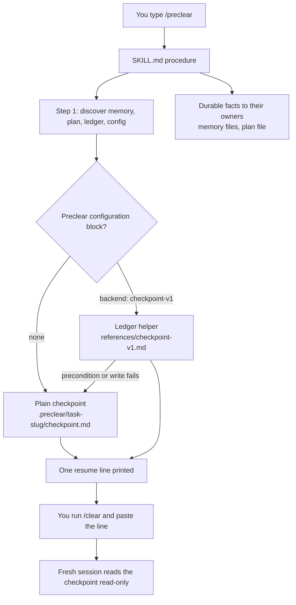

<p align="center">
  
</p>

<p align="center">
  <a href="https://x.com/bokiko"></a>
</p>

<p align="center">
  
  
  
  
</p>

---

## Overview

When you run `/clear` in Claude Code, the conversation is gone. The next session
then spends tokens working out what you were doing, what was decided, and what
comes next. `preclear` is a skill that writes the minimum a fresh session needs to
continue, puts each fact in the one place that owns it, and prints one
paste-ready line that points at the result.

It adapts to whatever you already have: plain memory files, a hub-style memory
index, a plan file, or an existing ledger helper. Nothing is installed, bound or
configured on your behalf.

> [!NOTE]
> It is a procedure the model follows, not a hook. Nothing enforces it, and it
> cannot control what the next session does with the checkpoint.

---

## Quick Start

### Prerequisites

- Claude Code with skills enabled (`SKILL.md` frontmatter, `/<name>` invocation).
- `git` on `PATH` if the project is a repository. preclear only reads it.

### Installation

Copy or symlink this folder to one of:

```bash
# Personal skill, available in every project
git clone https://github.com/bokiko/preclear.git ~/.claude/skills/preclear

# Or a project-local skill
git clone https://github.com/bokiko/preclear.git <repo>/.claude/skills/preclear
```

The skill is invoked only by typing `/preclear`. It never fires on its own,
because `SKILL.md` sets `disable-model-invocation: true`.

> [!WARNING]
> A personal skill named `preclear` takes precedence over a project installation
> of the same name. Before testing or migrating, check which `SKILL.md` will load.
> Move an old installation outside every skill directory before replacing it;
> renaming its folder alone can leave a conflicting frontmatter name. Start a
> fresh session after changing the installation. Never delete or overwrite an
> existing installation automatically.

### First run

In this order:

1. Run `/preclear`.
2. Copy the line it prints.
3. Run `/clear` yourself.
4. Paste the line into the new session.

preclear never runs `/clear` for you.

---

## Features

<table>
<tr>
<td width="50%">

### What it saves
<ul>
<li>One checkpoint per task, under 4,096 bytes, six fixed headings</li>
<li>One paste-ready resume line that authorizes exactly one next action</li>
<li>Durable facts routed to their existing owners: your memory files, your plan file</li>
<li>Frozen copies for handoffs, never overwritten</li>
<li>A <code>git status</code> sidecar when the status is long</li>
</ul>

</td>
<td width="50%">

### What it refuses
<ul>
<li>Any git mutation: no commit, add, stash, checkout, reset or rm</li>
<li>Deleting or overwriting files</li>
<li>Running <code>/clear</code> or compacting for you</li>
<li>Guessing: unknown state is written as <code>UNCONFIRMED</code></li>
<li>Installing, binding, changing settings, or activating a backend it merely found</li>
</ul>

</td>
</tr>
</table>

---

## Tech Stack

| Category | Technologies |
|----------|--------------|
| **Runtime** | Claude Code skill (`SKILL.md`, invoked as `/preclear`) |
| **Format** | Markdown checkpoint with six fixed headings, YAML configuration block |
| **Tools used** | Read, Write, Edit, Glob, Grep; read-only `git status`, `log`, `rev-parse`, `branch`, `diff` |
| **Optional backend** | `checkpoint-v1` ledger helper, opt-in through configuration only |
| **Tests** | Headless Claude Code runs against fixtures, evidence committed under `tests/evidence/` |

---

## Architecture



---

## Project Structure

```text
preclear/
├── SKILL.md                       # The procedure Claude Code runs on /preclear
├── references/
│   ├── configuration.md           # Opt-in configuration block and its three states
│   ├── checkpoint-v1.md           # Adapter for the checkpoint-v1 ledger helper
│   └── status-sidecar.md          # Quoted-porcelain fallback for the status sidecar
├── tests/
│   ├── acceptance.md              # Harness rules and the acceptance matrix
│   ├── fixtures/                  # plain-memory, hub-memory, bound-ledger projects
│   └── evidence/                  # Sanitized traces, snapshots and measurements per run
├── CHANGELOG.md
├── LICENSE
└── README.md
```

---

<details>
<summary><b>Configuration</b></summary>

None is needed. Without configuration preclear writes a plain checkpoint under
`<project>/.preclear/<task-slug>/`. Configuration is for users who already keep a
ledger or handoff system and want preclear to write through it. Backends are
opt-in only; finding a helper or a ledger on disk never activates one.

The block lives in an applicable `CLAUDE.md`, headed exactly `Preclear configuration`:

```yaml
preclear:
  version: 1
  backend: checkpoint-v1
  executable: /absolute/path/to/checkpoint
  project: /absolute/project
  task: stable-task-id
  ledger: /absolute/path/to/CONTINUITY.md
  fallback_directory: /absolute/project/.preclear
```

| Key | Required | Meaning |
|-----|----------|---------|
| `version` | yes | Integer. Only `1` exists. |
| `backend` | yes | A known backend name, not a path. |
| `executable` | per backend | Absolute path to the helper. Never resolved from `PATH`. |
| `project` | yes | Absolute physical project path the block applies to. |
| `task` | per backend | Stable task id. Required for any backend mutation. |
| `ledger` | per backend | Absolute path to the file the backend writes. |
| `fallback_directory` | no | Where a plain checkpoint goes when the backend cannot be used. Default `<project>/.preclear`. The literal `none` means no fallback is ever written. |

Full rules, including validation and the fallback policy, are in
`references/configuration.md`. When the NUL-separated status sidecar cannot be
captured, the quoted porcelain fallback in `references/status-sidecar.md` applies.

</details>

---

## Usage

### What it writes

By default, one checkpoint file per task:

```text
<project>/.preclear/<task-slug>/checkpoint.md
```

Optional files next to it:

- `checkpoint-<UTC-timestamp>-<4-char-random>.md`, a frozen copy. Written only
  for a handoff, a move to another person, machine or worktree, a project rule,
  or shared sessions. Never overwritten, nor are the sidecars it cites.
- `status.txt`, a sidecar with the full `git status` when it is long.

Other facts go to their existing owners (your memory files, your plan file) in
their own format, only when they are durable and not recoverable elsewhere.

preclear never edits `.gitignore`. If `.preclear/` is untracked it tells you once.
You decide whether to track it.

### After resuming

Do the authorized next action and update the normal plan as needed. Leave the
saved checkpoint unchanged; run `/preclear` again when you want a fresh verified
checkpoint. A checkpoint records its capture time and goes stale as work proceeds.

A resume line authorizes only the checkpoint's next action. Respect its allowed
paths and scratch or file-output limits; never delete files or bypass a denied
operation. Preserve existing checkpoint sidecars as well as the checkpoint. Create
another task artifact only when its output is authorized.

### Budgets

| Artifact | Cap |
|----------|-----|
| Checkpoint | under 4,096 bytes, six fixed headings |
| Resume package (checkpoint, resume line, required excerpts) | under about 6,000 bytes, roughly 2,000 tokens estimated as `ceil(bytes / 3)` |

> [!TIP]
> preclear prints the measured bytes. The token figure is an estimate, not a
> tokenizer count. Byte measurement may be unavailable under your tool
> permissions; unchecked sizes are reported as `UNCONFIRMED`, and an estimate
> never certifies a cap.

### Safety

Hard rules, as stated in `SKILL.md`:

- **Git is read-only.** `git status`, `git log`, `git rev-parse`, `git branch`,
  `git diff` are fine. Never `commit`, `push`, `add`, `stash`, `checkout`,
  `reset`, `rm`, or anything that mutates git state or the index. This also
  binds any helper you call.
- **Never delete files.** Update in place. Frozen snapshots and their sidecars are
  new files and are never overwritten.
- **Never run `/clear` or compact.** That is the user's move.
- If something is genuinely unknown, write it down as `UNCONFIRMED` rather than
  guessing. A checkpoint that invents state is worse than one that admits gaps.
- Never bypass a hook, edit a protected file via the shell, install anything,
  change settings, bind a session, or write a secret anywhere.
- Anything merely found is a candidate. Only explicit configuration (probe 4)
  activates a backend.
- Convert relative dates to absolute.

### Tests

See `tests/acceptance.md`. Fixtures are in `tests/fixtures/`, and every reviewed
run leaves sanitized evidence in `tests/evidence/`.

---

## Known issues and limits

- **Row 7 (all destinations denied):** destination handling passed; evidence integrity
  failed (Codex verdict). The printed checkpoint lists a "workspace policy/registry
  checked" fact that no tool call in that turn supports. It is kept as produced. Three
  reruns are planned, and the Roadmap item stays open.
- **Rows 1, 2, 3c, 4b carry forward** from the first pass on skill `bbda28403d95` and
  adapter `272838d4722d`. No edit changed the behaviour they test, and they have not
  been rerun on later digests.
- **Shipped skill digest not run:** matrix rows 5 to 12 and the reruns of 3a and 3b ran
  skill `6d22a71e7f3c`. The shipped `SKILL.md` is `86e5b14e64b1`: wording edits and a
  status-sidecar pointer were made in the same commit as rows 5 to 12. The planned full
  rerun is the first run of the shipped text and will be filed as a new baseline.
- **NUL `-z` status form never executed** under the headless tool policy (output
  redirection needs approval). Rows 10 and 11 passed through the documented
  quoted-porcelain fallback, so earlier acceptances are not exact-command tests for
  that form.
- **Smaller recorded defects:** the model's cap statements disagreed with the
  independent manifest in 5 of 12 checkpoint-producing runs (D1), and row 12 recorded
  one overrun (Resume reading 712 of 600 bytes).

Details: `tests/evidence/publication-2026-10-20/README.md`. Reviewer verdicts there come
from a Codex review and are recorded, not yet independently reproducible. That file also
mentions an audit record that is not part of this repository. The reproducible check is
`.gitleaks.toml` plus `scripts/prepublish-check.sh`.

---

## Roadmap

- [x] Plain-memory layout accepted after review (2026-10-19)
- [x] Hub-memory layout accepted after review (2026-10-19)
- [x] Bound-ledger backend (`checkpoint-v1`) accepted after review (2026-10-19)
- [x] Twelve-row publication matrix run and reviewed (2026-10-20)
- [ ] Clean rerun of publication row 7 (unsupported Do-not-redo entry)
- [x] Public release

---

## License

MIT - see [LICENSE](LICENSE) for details.

---


<p align="center">
  Made by <a href="https://bokiko.io">@bokiko</a>
</p>
